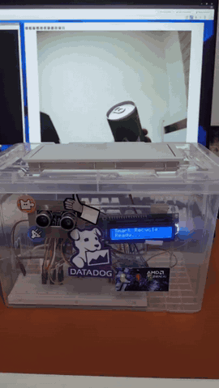
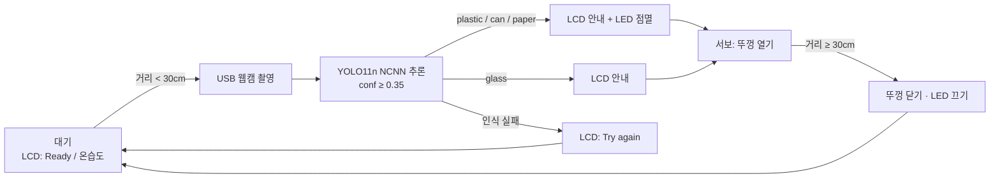

# ♻️ smart-recycle

**라즈베리 파이 5 기반 AIoT 스마트 분리수거함.** 쓰레기를 투입구에 가져다 대면 초음파 센서가 감지하고, 카메라와 YOLO11n 모델이 **플라스틱 / 캔 / 유리 / 종이**를 분류합니다. 분류 결과는 LCD 안내와 LED로 보여주고, 서보 모터가 뚜껑을 엽니다.

> 2026년 1학기 IoT 텀프로젝트 (가천대학교 컴퓨터공학과)

<p align="center">
  
  <br/>
  <sub>캔을 대면 LCD에 <code>Can / Metal · Red bin</code>이 뜨고 빨간 LED가 켜집니다</sub>
</p>

---

## 주요 기능

- **거리 기반 자동 감지**: HC-SR04 초음파 센서가 30cm 이내 물체를 감지하면 분류를 시작합니다.
- **온디바이스 AI 분류**: YOLO11n을 NCNN으로 변환해 라즈베리 파이 5 CPU에서 바로 추론합니다. 서버나 GPU가 필요 없습니다.
- **품목별 안내**: 16x2 I2C LCD에 품목과 버릴 통을 표시하고, 해당 색 LED를 깜빡입니다.
- **자동 뚜껑 개폐**: 분류에 성공하면 SG90 서보가 뚜껑을 열고, 물체가 멀어지면 닫습니다.
- **대기 중 온습도 표시**: 사용자가 없을 때 DHT11 온습도 값을 LCD에 주기적으로 표시합니다.
- **결과 기록**: 분류할 때마다 바운딩 박스를 그린 이미지(`waste_<timestamp>.jpg`)를 저장합니다.

## 동작 흐름



같은 물체를 반복해서 분류하지 않도록 분류 사이에 5초 간격(`CLASSIFY_INTERVAL`)을 둡니다.

## 하드웨어

| 부품 | 역할 | 연결 (BCM) |
|---|---|---|
| Raspberry Pi 5 | 메인 컨트롤러 + AI 추론 | - |
| USB 웹캠 | 쓰레기 촬영 | USB (`/dev/video0`) |
| HC-SR04 초음파 센서 | 투입 감지 | TRIG `GPIO23`, ECHO `GPIO24` |
| SG90 서보 모터 | 뚜껑 개폐 (0° 닫힘 / 90° 열림) | `GPIO18` |
| 16x2 I2C LCD (PCF8574, `0x27`) | 안내 메시지 | SDA `GPIO2`, SCL `GPIO3` |
| LED (초록) | 플라스틱 | `GPIO17` |
| LED (빨강) | 캔 / 금속 | `GPIO27` |
| LED (노랑) | 종이 | `GPIO22` |
| DHT11 | 온습도 | `GPIO4` |

> HC-SR04의 ECHO 출력은 5V이므로 전압 분배 저항을 거쳐 3.3V로 낮춰 연결해야 합니다.

### 분류 결과별 출력

| 품목 | LCD 1행 | LCD 2행 | LED |
|---|---|---|---|
| plastic | Plastic Bottle | Green bin | 초록 |
| can | Can / Metal | Red bin | 빨강 |
| paper | Paper | Yellow bin | 노랑 |
| glass | Glass | Glass bin | 없음 |

## AI 모델

| 항목 | 내용 |
|---|---|
| 모델 | YOLO11n (Pi 5 CPU에서 가장 가벼운 버전) |
| 배포 형식 | NCNN (`yolo11n_recycle_ncnn_model/`, 약 11MB) |
| 학습 데이터 | TACO + AI-Hub 생활폐기물 이미지 병합 |
| 클래스 | `0 plastic`, `1 can`, `2 glass`, `3 paper` |

### 성능 (검증 세트 mAP50)

| 평가 환경 | glass | can | paper | plastic | 전체 |
|---|---|---|---|---|---|
| 단일 물체, 깔끔한 배경 (실제 사용 환경) | 0.98 | 0.99 | 0.99 | 0.96 | **약 0.98** |
| 여러 쓰레기가 쌓인 장면 (TACO) | 0.01 | 0.37 | 0.26 | 0.51 | 0.29 |

- 투입구 앞에 물체를 하나씩 대는 방식이라 **단일 물체 성능이 실제 사용 환경에 가깝습니다.**
- AI-Hub 데이터는 같은 물체를 여러 각도로 찍은 이미지라 train/val에 같은 물체가 섞였을 수 있습니다. 그래서 단일 물체 점수는 실제보다 높게 나왔을 수 있습니다. 정확한 성능은 파이 카메라로 직접 찍은 데이터로 따로 평가해야 합니다.
- TACO 원본 60개 클래스를 분리수거 카테고리로 다시 매핑했고, 공식 annotation과 비공식 annotation을 합쳐서 썼습니다.

## 설치 및 실행

### 1. 라즈베리 파이 설정

```bash
sudo raspi-config        # Interface Options → I2C 활성화
sudo apt update
sudo apt install -y python3-pip python3-venv i2c-tools
i2cdetect -y 1           # LCD 주소(0x27) 확인
```

### 2. 패키지 설치

```bash
git clone https://github.com/taek5138/smart-recycle.git
cd smart-recycle
python3 -m venv --system-site-packages .venv
source .venv/bin/activate
pip install -r requirements.txt
```

### 3. 모델 준비

학습한 NCNN 모델 폴더(`yolo11n_recycle_ncnn_model/`)를 파이로 옮기고 경로를 지정합니다. 모델 파일은 용량 때문에 레포에 포함하지 않았습니다.

```bash
export MODEL_PATH=~/model/yolo11n_recycle_ncnn_model
```

> PC에서 학습한 `.pt` 가중치는 `yolo export model=best.pt format=ncnn` 으로 NCNN으로 변환할 수 있습니다.

### 4. 실행

```bash
python3 smart_recycle.py
```

LCD에 `Smart Recycle / Ready...`가 뜨면 준비가 끝난 것입니다. `Ctrl+C`로 종료하면 뚜껑을 닫고 GPIO와 카메라를 정리한 뒤 종료합니다.

### 주요 설정값 (`smart_recycle.py`)

| 변수 | 기본값 | 설명 |
|---|---|---|
| `DETECT_DIST` | `30` | 물체 감지 거리 (cm) |
| `CLASSIFY_INTERVAL` | `5` | 분류 최소 간격 (초) |
| `DHT_INTERVAL` | `5` | 온습도 표시 간격 (초) |
| `conf` | `0.35` | YOLO 신뢰도 임계값 |

## 한계와 개선 방향

- **LED 3개만 사용**: 부품이 부족해서 유리는 LED 없이 LCD로만 안내합니다.
- **투입구 1개**: 서보 모터가 하나라서 품목별로 통을 나누지 않고, 하나의 투입구에서 품목만 판별합니다. 서보를 품목 수만큼 늘리거나 회전판을 달면 실제 분리 배출까지 할 수 있습니다.
- **첫 번째 박스만 사용**: 여러 물체가 동시에 잡히면 모델이 반환한 첫 번째 박스로 판단합니다.
- **실사용 데이터 재학습**: 헷갈리는 프레임(신뢰도 0.35~0.65)을 모아 다시 학습하면 실제 카메라와 조명 환경에 맞게 성능을 올릴 수 있습니다.

## 확장: 데이터 분석 + 지역별 대시보드

후속 작업으로 분류 이벤트를 SQLite에 기록하고 분석하는 확장 버전을 설계했습니다 (이 레포에는 아직 포함되지 않음).

- **오염·오분류 탐지**: 통에 맞지 않는 품목이나 신뢰도가 낮은 투입을 경고하고 오염률을 계산
- **배출 패턴 분석**: 시간대·요일별 배출 패턴을 보고 통이 가득 차는 시점을 예측
- **능동학습**: 모델이 헷갈린 프레임을 자동으로 저장해 재학습 데이터로 활용
- **지역별 대시보드**: 여러 건물(가천관, AI공학관, 기숙사 등)에 설치된 장치가 중앙 서버로 이벤트를 보내고, Streamlit 대시보드에서 지역별로 비교

## 팀

| 이름 | 역할 |
|---|---|
| 김택현 | AI 모델 학습, 하드웨어 회로 구성, 센서 연결 |
| 권도윤 | 라즈베리 파이 환경 구축, 제어 코드 작성, 통합 테스트 |

## 기술 스택

`Python` · `YOLO11 (Ultralytics)` · `NCNN` · `OpenCV` · `lgpio` · `gpiozero` · `RPLCD` · `Adafruit DHT` · `Raspberry Pi 5`
